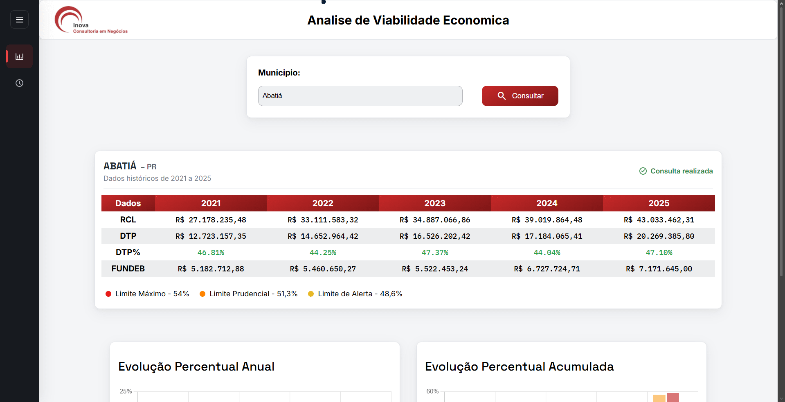
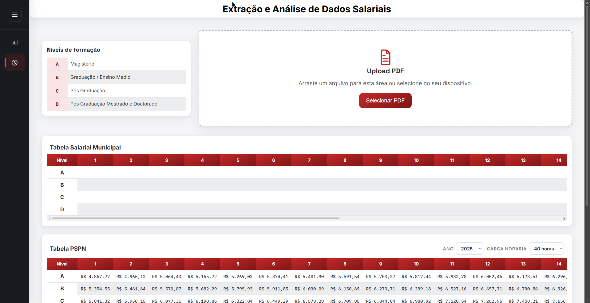

# Sistema de Análise de Viabilidade Econômica Municipal

Sistema web desenvolvido para automatizar a consulta, extração, organização e análise de informações fiscais e salariais de municípios do estado do Paraná.

O projeto reúne dados de indicadores fiscais municipais e informações salariais do magistério, permitindo visualizar históricos, realizar comparações e identificar possíveis defasagens em relação ao Piso Salarial Profissional Nacional (PSPN).

A aplicação foi desenvolvida com uma arquitetura dividida entre frontend e backend, utilizando JavaScript, Node.js e Python para integrar as funcionalidades de consulta, processamento e análise de dados.

---

## 1. Funcionalidades

### 1.1. Consulta de indicadores fiscais municipais

O sistema permite selecionar municípios do Paraná e consultar informações fiscais referentes aos anos de 2021 a 2025.

Os dados são obtidos por meio de um processo automatizado de consulta ao **Tribunal de Contas do Estado do Paraná (TCE-PR)**.

Entre os indicadores consultados estão:

- **RCL (Receita Corrente Líquida):** demonstra a capacidade de arrecadação do município, considerando as deduções previstas.
- **DTP (Despesa Total com Pessoal):** representa os gastos municipais com pessoal.
- **FUNDEB:** informações relacionadas aos recursos do Fundo de Manutenção e Desenvolvimento da Educação Básica.

Os resultados são organizados em tabelas e gráficos, facilitando a visualização do histórico dos indicadores e de suas variações percentuais anuais e acumuladas.

### 1.2. Extração e análise de dados salariais

O sistema também possui um módulo destinado ao processamento de documentos PDF contendo informações salariais.

O funcionamento ocorre por meio das seguintes etapas:

1. Recebimento do documento PDF.
2. Processamento do arquivo por um script Python.
3. Extração das informações salariais.
4. Organização dos dados extraídos.
5. Comparação dos valores com o Piso Salarial Profissional Nacional (PSPN).
6. Apresentação dos resultados para análise.

O sistema considera a jornada de trabalho informada para realizar a comparação proporcional com o piso salarial de referência.

Essa funcionalidade permite identificar diferenças entre os valores salariais encontrados nos documentos e os valores utilizados como referência.

---

## 2. Arquitetura e funcionamento

A aplicação utiliza uma arquitetura dividida em frontend e backend, com integração entre JavaScript e Python para executar diferentes responsabilidades.

### 2.1. Consulta de indicadores fiscais

O fluxo de consulta dos indicadores fiscais funciona da seguinte maneira:

1. O usuário seleciona um município na interface.
2. O frontend envia uma requisição para a API do backend.
3. O Node.js recebe a solicitação e executa o script Python responsável pela consulta.
4. O Python realiza a coleta dos dados disponibilizados pelo TCE-PR.
5. Os resultados são organizados em uma estrutura JSON.
6. O backend recebe e interpreta o retorno do Python.
7. A API disponibiliza os dados para o frontend.
8. O JavaScript apresenta as informações em tabelas e gráficos.

### 2.2. Extração de informações dos documentos PDF

Para o processamento dos documentos salariais, o backend utiliza scripts Python responsáveis pela extração e organização das informações.

Após o processamento, os dados são estruturados para que possam ser utilizados pelas funcionalidades de análise e comparação salarial.

### 2.3. Integração com a API do IBGE

A aplicação utiliza a API pública do IBGE para carregar dinamicamente a relação de municípios do estado do Paraná.

Dessa forma, a lista de municípios na barra de consultas não precisa ser cadastrada manualmente no código, facilitando sua manutenção.

---

## 3. Tecnologias utilizadas

| Tecnologia | Aplicação no projeto |
|---|---|
| HTML5 | Estrutura das páginas e elementos da interface. |
| CSS3 | Estilização, organização visual e responsividade. |
| JavaScript | Interações do frontend, requisições à API e apresentação dos dados. |
| Node.js | Execução do ambiente backend e integração entre os módulos. |
| Express | Criação e gerenciamento das rotas da API. |
| Python | Automação das consultas e processamento de documentos PDF. |
| Prisma ORM | Integração e manipulação dos dados armazenados no banco de dados. |
| API do IBGE | Consulta dinâmica dos municípios do Paraná. |
| TCE-PR | Fonte dos indicadores fiscais municipais. |

---

## 4. Futuras aplicações

O sistema possui possibilidades de expansão para ampliar suas funcionalidades e oferecer maior flexibilidade na consulta e análise dos dados municipais.

Entre as melhorias planejadas estão:

- **Filtro por ano:** permitir que o usuário selecione os anos que deseja consultar, possibilitando análises de períodos específicos e comparações históricas entre diferentes exercícios.
- **Ampliação das consultas históricas:** expandir a disponibilidade de dados para outros exercícios, conforme a disponibilidade das informações na fonte consultada.
- **Aprimoramento da visualização dos indicadores:** implementar novas formas de comparação e apresentação dos dados, facilitando a identificação de variações e tendências.

Essas melhorias fazem parte da evolução planejada do projeto e poderão ser implementadas conforme o desenvolvimento da aplicação.

## 5. Estrutura do projeto

```text
Analise-de-Viabilidade-Economica/
│
├── backend/
│   ├── api/
│   │   └── index.js
│   │
│   ├── generated/
│   ├── prisma/
│   ├── python/
│   │   ├── __pycache__/
│   │   ├── extrairPDF.py
│   │   ├── PDFteste.pdf
│   │   ├── salarios.json
│   │   └── tce_pr.py
│   │
│   ├── src/
│   │   ├── app.js
│   │   ├── prisma.js
│   │   ├── pspn.js
│   │   ├── routes.js
│   │   ├── seed.js
│   │   └── server.js
│   │
│   ├── .env.example
│   ├── package.json
│   ├── prisma.config.ts
│   └── vercel.json
│
├── front-end/
│   ├── img/
│   ├── js/
│   │   ├── api.js
│   │   ├── charts.js
│   │   ├── salarios.js
│   │   └── sidebar.js
│   │
│   ├── styles/
│   ├── DS.html
│   ├── index.html
│   └── package.json
│
├── .gitignore
└── README.md
```

### Organização dos principais arquivos

**Backend**

- `api/index.js`: ponto de entrada da aplicação para integração com o ambiente de execução da API.
- `src/app.js`: configuração da aplicação backend.
- `src/server.js`: inicialização do servidor.
- `src/routes.js`: definição das rotas e comunicação entre as requisições, o backend e os scripts Python.
- `src/prisma.js`: configuração da integração com o Prisma.
- `src/pspn.js`: funcionalidades relacionadas aos valores de referência do PSPN.
- `src/seed.js`: inicialização ou inserção de dados no banco de dados.
- `python/extrairPDF.py`: processamento e extração de informações de documentos PDF.
- `python/tce_pr.py`: automação da consulta dos indicadores fiscais municipais.
- `python/salarios.json`: arquivo utilizado para armazenar ou organizar informações salariais.

**Frontend**

- `index.html`: interface principal do sistema.
- `DS.html`: página relacionada ao módulo de análise salarial.
- `js/api.js`: comunicação com as rotas disponibilizadas pelo backend.
- `js/charts.js`: criação e atualização dos gráficos.
- `js/salarios.js`: funcionalidades relacionadas à análise salarial.
- `js/sidebar.js`: comportamento da navegação lateral.
- `styles/`: arquivos responsáveis pela estilização das páginas.
- `img/`: imagens utilizadas na interface.

---

## 6. Objetivo do projeto

O objetivo do sistema é reduzir etapas manuais na coleta e organização de informações municipais, facilitando a análise de indicadores fiscais e dados salariais.

Além de sua aplicação prática, o desenvolvimento permitiu trabalhar com integração entre diferentes tecnologias, construção de APIs, automação com Python, manipulação de documentos PDF, persistência de dados e visualização de informações.

---

## 7. Observações sobre os dados

Os dados utilizados na demonstração do módulo salarial podem conter informações simuladas, incluindo documentos PDF de teste e valores de referência utilizados durante o desenvolvimento.

Esses dados têm finalidade demonstrativa e não devem ser interpretados como uma auditoria ou confirmação de informações oficiais de remuneração municipal.

Os indicadores fiscais, por sua vez, são obtidos por meio do processo de consulta à fonte indicada no módulo.

---

## 8. Gif's de funcionamento do sistema

### 8.1 Consulta de indicadores fiscais municipais


### 8.2 Extração e análise de dados salariais


## Autor

**Yan Ablevitz de Deus Moura**

Estudante de Engenharia de Software, interessado em desenvolvimento backend, automação de processos, integração de APIs e gerenciamento de bancos de dados.

GitHub: [github.com/yanmouraa](https://github.com/yanmouraa)


